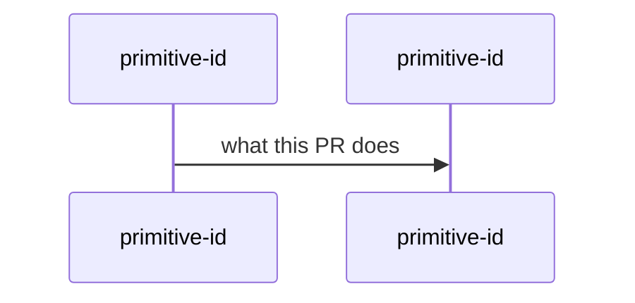

## Summary

## System recap

**Classification:** composes | extends | adds

**Primitives:**

Roll up to the highest class: `adds`, then `extends`, then `composes`. An `adds` updates `docs/primitives.yaml` in this PR.

## Verify verdict

Ready to ship | Not ready

## Risk tier

low | medium | high

`high` means this diff touches auth, billing, payments, data deletion, or migrations. High waits for James. Low and medium may auto-merge to `develop` when the gates pass.
