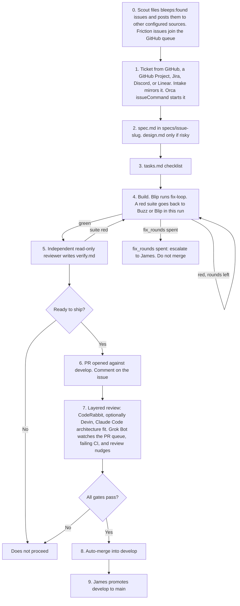

# Flow

Ticket-to-merge pipeline. Bleeps runs the crew. Bloops merges and reflects. Merge rules are in [0003: Gitflow auto-merge to develop](decisions/0003-gitflow-auto-merge-to-develop.md). The crew is [0010](decisions/0010-bleeps-runs-the-crew-bloops-reflects.md). Building blocks are in [primitives](primitives.md).

## Steps

0. On a schedule, Chip scans the project and files a GitHub issue labelled `bleeps:found` for each new finding. When the project lists another ticket source, Chip also creates that finding there. Open `friction` issues join the GitHub queue and are not filed again, and they are not copied. Each GitHub issue then enters step 1. See [0008](decisions/0008-bleeps-is-proactive.md) and [0013](decisions/0013-one-ticket-many-sources.md).
1. A ticket arrives from GitHub Issues, a GitHub Project, Jira, Discord, or Linear. The project chooses its sources. GitHub access is required either way. `scripts/intake` turns the ticket into one shape and, for a non-GitHub source, a GitHub issue labelled `bleeps:intake`. Orca's `issueCommand` takes that issue (`{{issue}}` and `{{artifact_url}}`). Beep plans with `scripts/kick-off`.
2. Write `spec.md` in `specs/<issue>-<slug>/`. Write `design.md` only if the approach is risky.
3. Write `tasks.md` as a checklist. Test tasks are included. Blip owns them. See [0009](decisions/0009-testing-is-a-gate-blip-owns-tests.md).
4. Build in an isolated Orca worktree. Blip writes or extends the tests and runs `scripts/fix-loop`. A red suite does not stop the run. Buzz fixes product code, or Blip fixes the test when the test itself is wrong, then Blip reruns. `fix_rounds` in `orca.project.yaml` defaults to 2. The next red escalates to James with a summary, and that run does not merge. Pause for human approval when a change touches a guardrail area: auth, billing, payments, data deletion, or migrations. See [0012](decisions/0012-red-suite-loops.md).
5. An independent read-only reviewer writes `verify.md`. It records unit, integration, and end-to-end. End-to-end is not applicable only when the project is not a web app. Only a "Ready to ship" verdict proceeds, and only when those layers are green. A red suite returns to step 4. A missing test command is not green. Any other not-ready verdict does not proceed.
6. Open a PR against `develop`, comment on the issue, and link the PR on the ticket source with `scripts/intake link-pr`.
7. Layered review: CodeRabbit, optionally Devin, and Claude Code for architecture fit. Grok Bot watches the PR queue, failing CI, and review nudges.
8. Auto-merge into `develop` when all gates pass: required checks green, verify verdict "Ready to ship", layered reviews passed with no blocking findings, and no guardrail area touched without human sign-off.
9. James promotes `develop` to `main`. Agents never touch `main`.

## Open

Whether there is a grooming or prioritization step before kick-off.

## Diagram

