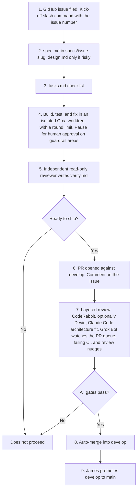

# Flow

Ticket-to-merge pipeline for Bleeps. A pull request that merges is a bloop. Merge rules are in [0003: Gitflow auto-merge to develop](decisions/0003-gitflow-auto-merge-to-develop.md). Building blocks are in [primitives](primitives.md).

## Steps

1. A GitHub issue is filed. The kick-off slash command takes the issue number.
2. Write `spec.md` in `specs/<issue>-<slug>/`. Write `design.md` only if the approach is risky.
3. Write `tasks.md` as a checklist.
4. Build, test, and fix in an isolated Orca worktree, with a round limit. Pause for human approval when a change touches a guardrail area: auth, billing, payments, data deletion, or migrations.
5. An independent read-only reviewer writes `verify.md`. Only a "Ready to ship" verdict proceeds.
6. Open a PR against `develop` and comment on the issue.
7. Layered review: CodeRabbit, optionally Devin, and Claude Code for architecture fit. Grok Bot watches the PR queue, failing CI, and review nudges.
8. Auto-merge into `develop` when all gates pass: required checks green, verify verdict "Ready to ship", layered reviews passed with no blocking findings, and no guardrail area touched without human sign-off.
9. James promotes `develop` to `main`. Agents never touch `main`.

## Open

Whether there is a grooming or prioritization step before kick-off.

## Diagram

