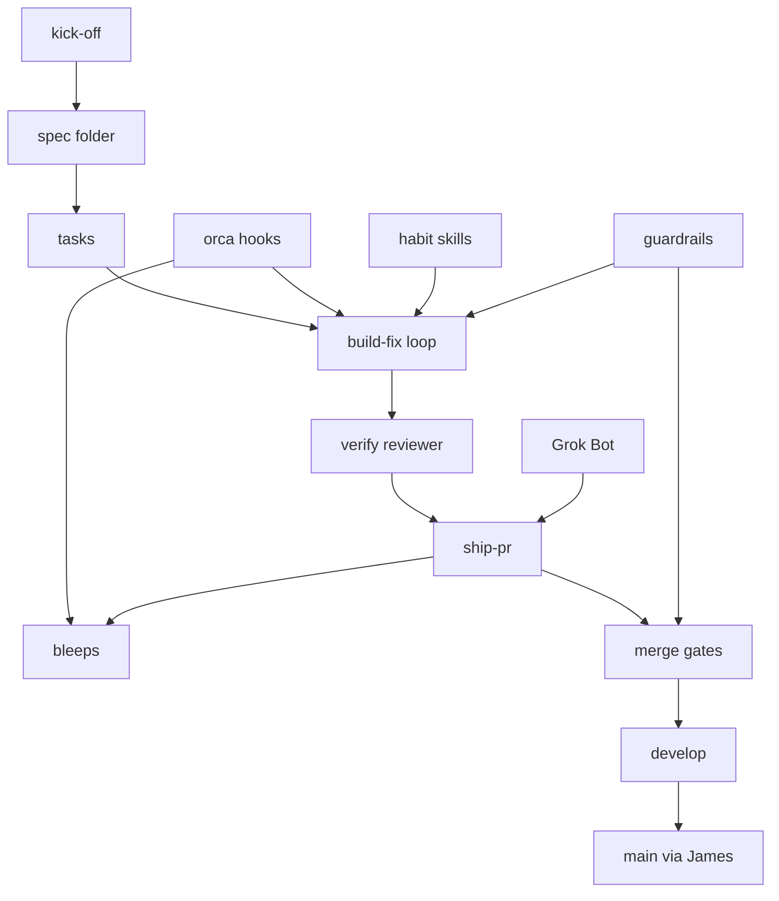

# Primitives

A primitive is the smallest reusable building block a person or an agent invokes in Bleeps. Bleeps is the system that turns a ticket into a merged pull request. A shipped pull request or feature is a bloop. Bleeps and Bloops is the brand.

A primitive is one of these kinds:

- A **slash command**, such as kick-off.
- A **skill**, such as the habit skills or the ship-pr judgment.
- An **agent role**, such as the verify reviewer.
- A **script or CLI command**, such as `bleeps`. The ship-pr procedure will be a script too, and it stays on the ship-pr row with the skill.
- A **hook**, such as the Orca setup and verification hooks.
- A **gate or check**, such as the guardrails and the merge gates.
- An **artifact**, such as `spec.md`, `tasks.md`, or `verify.md`.
- A **config**, such as the shared `orca.yaml`.

The shared `orca.yaml` is the config those pieces will live in: the slash command, the hooks, the review rules, and the merge policy. Each of those is its own row. A smaller file overrides the shared one per project. See [0001](decisions/0001-shared-factory-config.md).

`status: planned` means the block is specified and nobody can run it yet. `status: built` means a person or an agent can invoke it. This catalog is all planned. Phase 1 has the agreements and the designs. The [roadmap](roadmap.md) is the list that moves.

The machine-readable list is [primitives.yaml](primitives.yaml). Update that file when a primitive is added, removed, or reshaped. Leave its `summary` alone for ordinary feature work. To put this on a repo of your own, read [Using Bleeps](using-bleeps.md).

CodeRabbit, Devin, and Claude Code are the layered reviewers in [flow](flow.md) step 7. They are tools on the line, not rows here. Devin is optional.

## Where they sit

The diagram follows the ticket. Side arrows are primitives that join that step. `bleeps` is how the verification hook and, after a merge, ship-pr prove the change. Both calls are planned.

## Slash command

### Kick-off command

**Kind.** Slash command.

**Purpose.** Takes a GitHub issue number and starts the ticket.

**Inputs.** A GitHub issue number.

**Outputs.** The ticket run, starting with the spec folder.

**Invoked by.** A person.

**When.** [Flow](flow.md) step 1, once a GitHub issue exists.

**Status.** Planned.

**Lives.** Planned for the shared `orca.yaml`. It is not in this repo. The 2026-11-11 context pack command is reference only.

## Skill

### Build / fix loop

**Kind.** Skill.

**Purpose.** Build, test, and fix in an isolated Orca worktree, with a round limit, and pause when a change touches a guardrail area.

**Inputs.** `tasks.md`, and the repo in an isolated Orca worktree.

**Outputs.** The change on a feature branch. A pause when the change touches a guardrail area.

**Invoked by.** The agent on the ticket, inside the worktree.

**When.** Flow step 4. The number of rounds is not chosen yet.

**Status.** Planned.

**Lives.** Not written. [0002](decisions/0002-rebuild-factory-clean.md) says to write the loop fresh.

### Habit skills

**Kind.** Skill.

**Purpose.** Four habits, carried forward from the context pack and rewritten clean: explore-first, delegate-cheap-work, verify-before-ship, and decompose-hotspot.

**Inputs.** explore-first takes a search that would take three or more lookups. delegate-cheap-work takes a task whose success fits in one sentence. verify-before-ship takes a UI change. decompose-hotspot takes a file that keeps attracting changes.

**Outputs.** explore-first returns a short synthesis. delegate-cheap-work returns a diff to skim. verify-before-ship looks at about 390px and 1280px and reads the console. decompose-hotspot proposes a split of three to five files and waits.

**Invoked by.** Whichever agent is doing the work.

**When.** During the build, and on any task where the habit applies.

**Status.** Planned.

**Lives.** Not rewritten into Bleeps yet. Reference copies sit in the context pack. Those copies are not this primitive.

### Ship PR

**Kind.** Skill, with a script for the procedure.

**Purpose.** The skill is judgment: the risk tier, what to fix, and when to stop. The script will run tick, act, tick for CI, reviews, memory, merge, and health.

**Inputs.** A pull request URL, and a risk tier of low, medium, or high.

**Outputs.** A merge into `develop`, or the pull request parked. High risk returns waiting for James. After a real merge, a health check, once `bleeps health` exists. A reminder to file leftover papercuts on the [friction log](friction-log.md).

**Invoked by.** The agent shepherding the pull request.

**When.** After the pull request is open, through layered review, the gates, and the health check.

**Status.** Planned. The design is in [Ship a PR](ship-pr.md). The skill file and the script are not in the repo.

**Lives.** [docs/ship-pr.md](ship-pr.md).

## Agent role

### Verify reviewer

**Kind.** Agent role.

**Purpose.** An independent read-only reviewer. It does not share the implementer's context. It writes `verify.md`. Only "Ready to ship" proceeds.

**Inputs.** The spec folder and the change, without the implementer's context.

**Outputs.** `specs/<issue>-<slug>/verify.md`, and a verdict. Only "Ready to ship" continues to a pull request.

**Invoked by.** Its own read-only agent. Not the implementer.

**When.** Flow step 5, after the build loop.

**Status.** Planned.

**Lives.** Not written. The verdict file lives in the spec folder.

### Grok Bot watcher

**Kind.** Agent role.

**Purpose.** A long-running watch for the pull request queue, failing CI, and review nudges. Later, the daily friction sweep can live here.

**Inputs.** The pull request queue, CI results, and review state. Later, open issues labeled `friction`.

**Outputs.** Nudges. Later, one list of friction issues handed to an agent. It does not merge, and it does not touch `main`.

**Invoked by.** Nobody starts it per ticket. It runs as a watch.

**When.** Beside flow step 7. The friction sweep starts after the review layer is in place.

**Status.** Planned.

**Lives.** Described in [architecture](architecture.md). No bot is running.

## Script or CLI

### bleeps

**Kind.** Script or CLI command.

**Purpose.** One CLI agents use to prove a change with tests, typecheck, preview, and the deployed SHA. A green check is not evidence.

**Inputs.** The project. `health` takes a commit SHA, and can wait.

**Outputs.** `doctor`, `test`, and `typecheck`. A preview URL. A health pass only when the deployed SHA matches.

**Invoked by.** Agents. The Orca verification hook will call `test` and `typecheck`. ship-pr will call `health` after a merge.

**When.** `test` and `typecheck` during verification, in Phase 1. `preview` and `health` in Phase 3.

**Status.** Planned. The command is not implemented. The design is in [Control CLI](control-cli.md).

**Lives.** It will live in this repo. Projects symlink it the same way they symlink the shared `orca.yaml`.

## Hook

### Orca worktree hooks

**Kind.** Hook.

**Purpose.** On the shared `orca.yaml`: a setup hook installs deps when a worktree is created, and a verification hook runs tests and typecheck and blocks the pull request on failure.

**Inputs.** A new worktree, for setup. The change under test, for verification.

**Outputs.** Dependencies installed in the worktree. A test and typecheck result that blocks the pull request on failure.

**Invoked by.** Orca, not a person.

**When.** Setup runs when a worktree is created. Verification runs before a pull request can pass.

**Status.** Planned.

**Lives.** The shared `orca.yaml`, which is not written yet. A smaller per-project file overrides it.

## Gate or check

### Guardrails

**Kind.** Gate or check.

**Purpose.** Auth, billing, payments, data deletion, and migrations wait for James. A touch without his sign-off does not auto-merge.

**Inputs.** The diff, checked for those five areas.

**Outputs.** A pause in the build until James signs off. A refused auto-merge when a guardrail was touched without that sign-off.

**Invoked by.** The build loop pauses. The merge gates check. James signs off.

**When.** During the build loop, and again at merge.

**Status.** Planned. The list is settled in [0003](decisions/0003-gitflow-auto-merge-to-develop.md). No hook or script enforces it yet.

**Lives.** The decisions and [Ship a PR](ship-pr.md). On a project you adopt, the human who signs off is the owner. Here, that owner is James.

### Merge gates

**Kind.** Gate or check.

**Purpose.** Auto-merge to `develop` when the checks are green, verify says "Ready to ship", layered reviews have no blocking findings, and guardrails are signed off. James promotes `develop` to `main`. Agents never touch `main`.

**Inputs.** Required checks. The verify verdict. Layered reviews. Guardrail sign-off when a guardrail area was touched. Label rules can still keep a ticket from auto-merging.

**Outputs.** A merge into `develop`, or the pull request stays open. Promotion of `develop` to `main` stays with James.

**Invoked by.** The ship-pr script, once it exists.

**When.** Flow step 8. James's promotion is the step after it, and agents do not run that step.

**Status.** Planned. The rule is in [0003](decisions/0003-gitflow-auto-merge-to-develop.md). Branch protection and auto-merge are Phase 3, and are not turned on.

**Lives.** [Flow](flow.md) and the ship-pr merge step.

## Artifact

`verify.md` is the verify reviewer's output, so it stays on that row. `tasks.md` has its own row because the build loop works the checklist.

### Spec folder

**Kind.** Artifact.

**Purpose.** `specs/<issue>-<slug>/` holds `ticket.md`, `spec.md` (draft or approved), optional `design.md`, `tasks.md`, and `verify.md`.

**Inputs.** The GitHub issue.

**Outputs.** `ticket.md`. `spec.md`, with status draft or approved. `design.md` only if the approach is risky. `tasks.md` and `verify.md` are written by their own steps.

**Invoked by.** The agent running kick-off.

**When.** Flow step 2. The folder stays through verify.

**Status.** Planned.

**Lives.** `specs/<issue>-<slug>/` in the project repo, created per ticket.

### Tasks

**Kind.** Artifact.

**Purpose.** `tasks.md` is the checklist the build loop works through.

**Inputs.** The spec folder, including `spec.md` and `design.md` when it exists.

**Outputs.** `specs/<issue>-<slug>/tasks.md`.

**Invoked by.** The agent running kick-off, after the spec.

**When.** Flow step 3. The build loop reads it in step 4.

**Status.** Planned.

**Lives.** `specs/<issue>-<slug>/tasks.md`.

## How to add a new primitive

Read the [decisions](decisions/README.md) first. They are the veto list. If a record already covers the need, use that primitive.

1. Prefer wiring a primitive that exists. That pull request is `composes`. Leave `summary` alone.
2. When you change what a primitive does or promises, the class is `extends`. Update this page and [primitives.yaml](primitives.yaml) in that pull request.
3. A new block is `adds`. Give it an `id`, a kind (`group`), a one-sentence `summary`, inputs, outputs, who invokes it, when it runs, `status: planned` until someone can run it, where it lives, the docs that define it, and the decisions that shaped it.
4. Put the same entry on this page, under its kind.
5. Open the pull request against `develop`. An `adds` is worth reading. It is not automatically high risk. High risk is a guardrail area.

Agents merge only to `develop`. James merges `develop` into `main`.

## Recap

Every PR description includes a recap, from the [pull request template](../.github/pull_request_template.md). The recap classifies the change so James reviews the system, not only the diff.

| Class | Meaning |
| --- | --- |
| `composes` | Wires existing primitives. No contract change. |
| `extends` | Changes a primitive's behavior or contract. |
| `adds` | Introduces a primitive. Update [primitives.yaml](primitives.yaml) in that PR. |

Roll up to the highest class: `adds`, then `extends`, then `composes`.

The risk tier is separate. `high` means the diff touches a guardrail area (auth, billing, payments, data deletion, migrations) and waits for James. `low` and `medium` may auto-merge to `develop` when the gates pass. An `adds` is worth reading. It is not automatically `high`.

## Invariants

- Agents merge only to `develop`, and only through the gates. James merges `develop` into `main`.
- A bloop needs verify verdict "Ready to ship".
- Guardrail areas wait for James: auth, billing, payments, data deletion, migrations.
- The verify reviewer is read-only and does not share the implementer's context.
- One shared `orca.yaml`. Projects override in a smaller file.
- A PR recap names `composes`, `extends`, or `adds`. An `adds` updates the catalog in that PR.
- The ship-pr skill judges. The script, once it exists, performs the procedure.
- A green check is not deployed proof. `bleeps health --sha` is, once the CLI exists.
