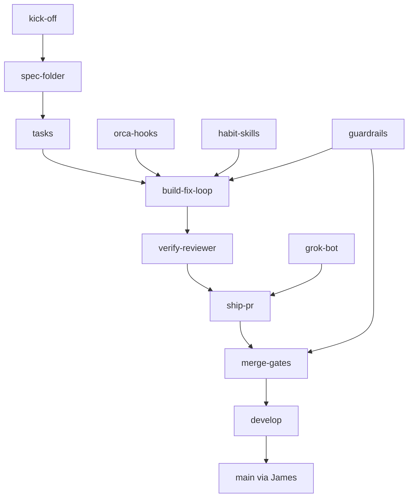

# Primitives

Catalog of Bleeps' building blocks. The machine-readable list is [primitives.yaml](primitives.yaml). Update that file when a primitive is added, removed, or reshaped. Leave its `summary` alone for ordinary feature work.

Every PR description includes a recap, from the [pull request template](../.github/pull_request_template.md). The recap classifies the change so James reviews the system, not only the diff.

| Class | Meaning |
| --- | --- |
| `composes` | Wires existing primitives. No contract change. |
| `extends` | Changes a primitive's behavior or contract. |
| `adds` | Introduces a primitive. Update [primitives.yaml](primitives.yaml) in that PR. |

Roll up to the highest class: `adds`, then `extends`, then `composes`.

The risk tier is separate. `high` means the diff touches a guardrail area (auth, billing, payments, data deletion, migrations) and waits for James. `low` and `medium` may auto-merge to `develop` when the gates pass. An `adds` is worth reading. It is not automatically `high`.

## Diagram

## Invariants

- Agents merge only to `develop`, and only through the gates. James merges `develop` into `main`.
- A bloop needs verify verdict "Ready to ship".
- Guardrail areas wait for James: auth, billing, payments, data deletion, migrations.
- The verify reviewer is read-only and does not share the implementer's context.
- One shared `orca.yaml`. Projects override in a smaller file.
- A PR recap names `composes`, `extends`, or `adds`. An `adds` updates the catalog in that PR.
- The ship-pr skill judges. The script, once it exists, performs the procedure.
- A green check is not deployed proof. `bleeps health --sha` is, once the CLI exists.
