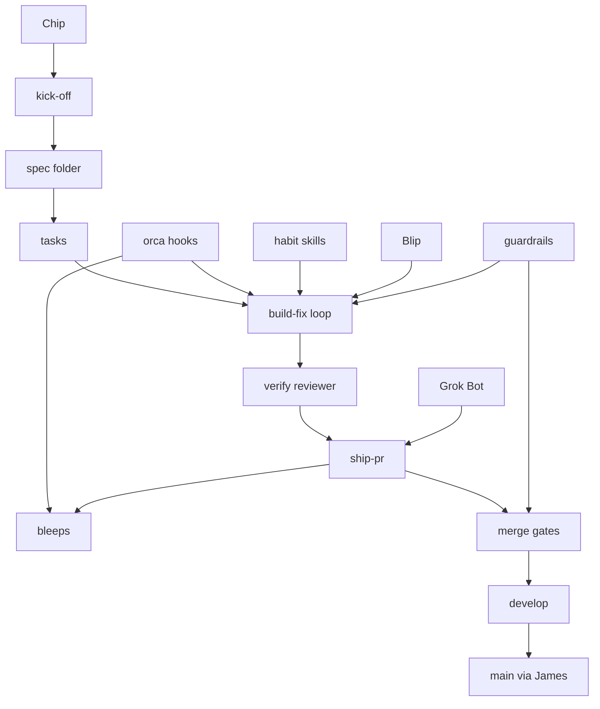

# Primitives

A primitive is the smallest reusable building block a person or an agent invokes. Bleeps runs the crew. Bloops merges and reflects. Bleeps and Bloops is the brand. Outputs do not need a name.

A primitive is one of these kinds:

- An **issue command**, such as kick-off. Orca sends it from `orca.yaml`.
- A **skill**, such as the habit skills or the ship-pr judgment.
- An **agent role**, such as the verify reviewer.
- A **script or CLI command**, such as `bleeps`. The ship-pr procedure will be a script too, and it stays on the ship-pr row with the skill.
- A **hook**, such as the Orca setup hook. Verification is `scripts/orca-verify`, because Orca has no verification key.
- A **gate or check**, such as the guardrails and the merge gates.
- An **artifact**, such as `spec.md`, `tasks.md`, or `verify.md`.
- A **config**, such as the shared `orca.yaml`.

The shared [`orca.yaml`](../orca.yaml) is the config those pieces live in. Kick-off is `issueCommand`. Setup is `scripts.setup`. Review rules and merge policy stay their own rows, because Orca has no keys for them. A project commits `orca.project.yaml` for install, test, and typecheck. Orca does not merge that file. See [0001](decisions/0001-shared-factory-config.md) and [0007](decisions/0007-bleeps-is-built-for-orca.md).

`status: planned` means the block is specified and nobody can run it yet. `status: built` means a person or an agent can invoke it. Kick-off, the setup hook, `bleeps test` / `bleeps typecheck`, the fix loop, Chip, and Blip are built. Orca is not installed for this repo yet. Where it runs is a [choice](where-it-runs.md). The [roadmap](roadmap.md) is the list that moves.

The machine-readable list is [primitives.yaml](primitives.yaml). Update that file when a primitive is added, removed, or reshaped. Leave its `summary` alone for ordinary feature work. To put this on a repo of your own, read [Using Bleeps](using-bleeps.md).

Ping is the review bot when you run the crew as bots. `review_external` defaults to `none` and installs nothing. CodeRabbit or Copilot count only when that key names them and the review actually ran.

## Where they sit

The diagram follows the ticket. Side arrows are primitives that join that step. `bleeps` is how `scripts/orca-verify` and, after a merge, ship-pr prove the change. The health call is still planned.

## Issue command

### Kick-off command

**Kind.** Issue command.

**Purpose.** Orca's `issueCommand`. It starts the ticket when a workspace launches from a linked GitHub issue. A Jira, Discord, Linear, or GitHub Project ticket is mirrored to that issue first. See [tickets](tickets.md).

**Inputs.** The linked GitHub issue. Orca substitutes `{{issue}}` and `{{artifact_url}}`. `scripts/intake` fills `ticket.md` when the issue is a mirror.

**Outputs.** The ticket run, starting with the spec folder.

**Invoked by.** Orca. A person launches the workspace from the issue.

**When.** [Flow](flow.md) step 1, once a GitHub issue exists.

**Status.** Built. The prompt is in [`orca.yaml`](../orca.yaml). Orca is not installed for this repo yet.

**Lives.** `orca.yaml` `issueCommand`. The 2026-11-11 `/bb:kick-off` command is reference only. See [0007](decisions/0007-bleeps-is-built-for-orca.md).

## Skill

### Build / fix loop

**Kind.** Skill.

**Purpose.** Build in an isolated Orca worktree. A red suite goes back to Buzz or Blip in the same run, up to `fix_rounds`, and pauses when a change touches a guardrail area.

**Inputs.** `tasks.md`, the repo in an isolated Orca worktree, and `fix_rounds` in `orca.project.yaml` (default 2).

**Outputs.** The change on a feature branch when the suite is green. A summary for James when `fix_rounds` is spent. A pause when the change touches a guardrail area.

**Invoked by.** The agent on the ticket, inside the worktree. Blip runs `scripts/fix-loop`.

**When.** Flow step 4. Two red send-backs, then the next red escalates. See [0012](decisions/0012-red-suite-loops.md).

**Status.** Built. Orca is not installed for this repo yet.

**Lives.** [`scripts/fix-loop`](../scripts/fix-loop). The crew still does the editing. [0002](decisions/0002-rebuild-factory-clean.md) said to write the loop fresh.

### Habit skills

**Kind.** Skill.

**Purpose.** Four habits, carried forward from the context pack and rewritten clean: explore-first, delegate-cheap-work, verify-before-ship, and decompose-hotspot.

**Inputs.** explore-first takes a search that would take three or more lookups. delegate-cheap-work takes a task whose success fits in one sentence. verify-before-ship takes a UI change. decompose-hotspot takes a file that keeps attracting changes.

**Outputs.** explore-first returns a short synthesis. delegate-cheap-work returns a diff to skim. verify-before-ship looks at about 390px and 1280px and reads the console. decompose-hotspot proposes a split of three to five files and waits.

**Invoked by.** Whichever agent is doing the work.

**When.** During the build, and on any task where the habit applies.

**Status.** Planned.

**Lives.** Not rewritten into Bleeps yet. Reference copies sit in the context pack. Those copies are not this primitive.

### Ship PR

**Kind.** Skill, with a script for the procedure.

**Purpose.** The skill is judgment: the risk tier, what to fix, and when to stop. The script will run tick, act, tick for CI, reviews, memory, merge, and health.

**Inputs.** A pull request URL, and a risk tier of low, medium, or high.

**Outputs.** A merge into `develop`, or the pull request parked. High risk returns waiting for James. After a real merge, a health check, once `bleeps health` exists. A reminder to file leftover papercuts on the [friction log](friction-log.md).

**Invoked by.** The agent shepherding the pull request.

**When.** After the pull request is open, through layered review, the gates, and the health check.

**Status.** Planned. The judgment is in [Ship a PR](ship-pr.md). [`scripts/ship-pr`](../scripts/ship-pr) refuses to merge.

**Lives.** [docs/ship-pr.md](ship-pr.md) and `scripts/ship-pr`.

## Agent role

### Verify reviewer

**Kind.** Agent role.

**Purpose.** An independent read-only reviewer. It does not share the implementer's context. It writes `verify.md`. Only "Ready to ship" proceeds.

**Inputs.** The spec folder and the change, without the implementer's context.

**Outputs.** `specs/<issue>-<slug>/verify.md`, and a verdict. Only "Ready to ship" continues to a pull request.

**Invoked by.** Its own read-only agent. Not the implementer.

**When.** Flow step 5, after the build loop.

**Status.** Planned.

**Lives.** Not written. The verdict file lives in the spec folder.

### Grok Bot watcher

**Kind.** Agent role.

**Purpose.** A long-running watch for the pull request queue, failing CI, and review nudges. The daily friction sweep is the scout.

**Inputs.** The pull request queue, CI results, and review state.

**Outputs.** Nudges. It does not merge, and it does not touch `main`.

**Invoked by.** Nobody starts it per ticket. It runs as a watch.

**When.** Beside flow step 7.

**Status.** Planned.

**Lives.** Described in [architecture](architecture.md). No bot is running. The friction sweep is the scout.

### Blip

**Kind.** Agent role.

**Purpose.** Owns unit, integration, and end-to-end tests. A red suite loops in the run until green or `fix_rounds` escalates to James. Green tests are a hard gate for auto-merge.

**Inputs.** The project stack and the test commands in `orca.project.yaml`. The ticket diff. Scout findings for gaps and flakes.

**Outputs.** Scaffolded suites. Tests for the change. A `verify.md` record of the three layers. End-to-end is not applicable only when the project is not a web app.

**Invoked by.** The pipeline agent, in a fresh session that has read [agents/blip/ROLE.md](../agents/blip/ROLE.md). `issueCommand` names that file. Orca has no agent-role key.

**When.** Onboarding, during flow steps 3 and 4, and when the scout files a coverage or flake finding.

**Status.** Built. Orca is not installed for this repo yet.

**Lives.** [agents/blip](../agents/blip) and [`scripts/fix-loop`](../scripts/fix-loop). See [0009](decisions/0009-testing-is-a-gate-blip-owns-tests.md) and [0012](decisions/0012-red-suite-loops.md).

## Script or CLI

### Chip

**Kind.** Script.

**Purpose.** Chip's patrol. On a schedule, scan the project, file a `bleeps:found` issue per new finding, post that finding to each other configured ticket source, and start the normal pipeline up to a cap.

**Inputs.** `proactive`, `host`, scans, schedule, cap, and `ticket_sources` in `orca.project.yaml`. Chip's provider and model from `scripts/providers` (Claude Code and `haiku` unless overridden). The worktree. GitHub, when `gh` is available. `host` defaults to `local`.

**Outputs.** Issues labelled `bleeps:found`, with evidence. A copy on each configured source other than plain GitHub issues. Orca worktrees for those issues, up to the cap. Open `friction` issues are queued and not filed again, and they are not copied.

**Invoked by.** An Orca automation. A person can run `bleeps scout`.

**When.** Flow step 0. Default daily at 09:00.

**Status.** Built. Register the automation with `bleeps scout schedule`. It is not an `orca.yaml` key.

**Lives.** [scripts/bleeps-scout](../scripts/bleeps-scout). See [0008](decisions/0008-bleeps-is-proactive.md), [0013](decisions/0013-one-ticket-many-sources.md), and [0014](decisions/0014-where-it-runs.md).

### Ticket intake

**Kind.** Script.

**Purpose.** Fetch a ticket from GitHub, a GitHub Project, Jira, Discord, or Linear, write the same ticket shape, and hand it to kick-off. Post status and the pull request link back when the source supports it.

**Inputs.** `ticket_sources` and credential env var names in `orca.project.yaml`. A source id. GitHub access, which is required even when the ticket lives somewhere else.

**Outputs.** `specs/<issue>-<slug>/ticket.json` and `ticket.md`. A GitHub issue labelled `bleeps:intake` when the source is not GitHub. A status or pull request link on the source.

**Invoked by.** Beep, at the start of `issueCommand`. The crew, when a pull request opens. A person can run `scripts/intake` and `scripts/check-ticket-sources`.

**When.** Flow step 1, and again at flow step 6 for the pull request link.

**Status.** Built for fixture responses. Live calls need the credentials named in [tickets](tickets.md). Those calls have not been run on a machine yet.

**Lives.** [scripts/intake](../scripts/intake), `scripts/ticket-github`, `scripts/ticket-github-project`, `scripts/ticket-jira`, `scripts/ticket-discord`, `scripts/ticket-linear`, and [scripts/check-ticket-sources](../scripts/check-ticket-sources). See [0013](decisions/0013-one-ticket-many-sources.md).

### bleeps

**Kind.** Script or CLI command.

**Purpose.** One CLI agents use to prove a change with tests, typecheck, preview, and the deployed SHA. A green check is not evidence.

**Inputs.** The project. `health` takes a commit SHA, and can wait.

**Outputs.** `doctor`, `test`, and `typecheck`. A preview URL. A health pass only when the deployed SHA matches.

**Invoked by.** Agents. `scripts/orca-verify` calls `test` and `typecheck`. The setup hook calls `install`. ship-pr will call `health` after a merge.

**When.** `test` and `typecheck` during verification. `preview` and `health` in Phase 3.

**Status.** Built for `install`, `doctor`, `test`, and `typecheck`. `preview` and `health` refuse. The design is in [Control CLI](control-cli.md).

**Lives.** [`scripts/bleeps`](../scripts/bleeps). Projects symlink it the same way they symlink the shared `orca.yaml`.

## Hook

### Orca worktree hooks

**Kind.** Hook.

**Purpose.** On the shared `orca.yaml`, `scripts.setup` installs dependencies when Orca creates a worktree. `scripts/orca-verify` runs tests and typecheck. Orca has no verification key. A required GitHub check is what can block the pull request.

**Inputs.** A new worktree, for setup. The change under test, for `scripts/orca-verify`.

**Outputs.** Dependencies installed in the worktree. A test and typecheck result. The pull request stays blocked only when GitHub requires that check.

**Invoked by.** Orca runs setup. The kick-off prompt runs `scripts/orca-verify`. A person can run either.

**When.** Setup runs when a worktree is created. Verification runs before a pull request is opened, and again in CI when the check is required.

**Status.** Built. Orca is not installed for this repo yet.

**Lives.** [`orca.yaml`](../orca.yaml), [`scripts/orca-setup`](../scripts/orca-setup), and [`scripts/orca-verify`](../scripts/orca-verify). Projects commit `orca.project.yaml`. The example is [examples/orca.project.yaml](../examples/orca.project.yaml).

## Gate or check

### Guardrails

**Kind.** Gate or check.

**Purpose.** Auth, billing, payments, data deletion, and migrations wait for James. A touch without his sign-off does not auto-merge.

**Inputs.** The diff, checked for those five areas.

**Outputs.** A pause in the build until James signs off. A refused auto-merge when a guardrail was touched without that sign-off.

**Invoked by.** The build loop pauses. The merge gates check. James signs off.

**When.** During the build loop, and again at merge.

**Status.** Planned. The list is settled in [0003](decisions/0003-gitflow-auto-merge-to-develop.md). [`scripts/guardrails`](../scripts/guardrails) reports matching paths and exits 2. It does not block a merge.

**Lives.** The decisions, [Ship a PR](ship-pr.md), and `scripts/guardrails`. On a project you adopt, the human who signs off is the owner. Here, that owner is James.

### Merge gates

**Kind.** Gate or check.

**Purpose.** Auto-merge to `develop` when the checks are green, verify says "Ready to ship", layered reviews have no blocking findings, and guardrails are signed off. James promotes `develop` to `main`. Agents never touch `main`.

**Inputs.** Required checks. The verify verdict. Layered reviews. Guardrail sign-off when a guardrail area was touched. Label rules can still keep a ticket from auto-merging.

**Outputs.** A merge into `develop`, or the pull request stays open. Promotion of `develop` to `main` stays with James.

**Invoked by.** The ship-pr script, once it exists.

**When.** Flow step 8. James's promotion is the step after it, and agents do not run that step.

**Status.** Planned. The rule is in [0003](decisions/0003-gitflow-auto-merge-to-develop.md). Branch protection and auto-merge are Phase 3, and are not turned on.

**Lives.** [Flow](flow.md) and the ship-pr merge step.

## Artifact

`verify.md` is the verify reviewer's output, so it stays on that row. `tasks.md` has its own row because the build loop works the checklist.

### Spec folder

**Kind.** Artifact.

**Purpose.** `specs/<issue>-<slug>/` holds `ticket.md`, `spec.md` (draft or approved), optional `design.md`, `tasks.md`, and `verify.md`.

**Inputs.** The normalized ticket. For a GitHub issue that is the whole ticket. For another source, the mirror issue plus `ticket.json`.

**Outputs.** `ticket.md`. `spec.md`, with status draft or approved. `design.md` only if the approach is risky. `tasks.md` and `verify.md` are written by their own steps.

**Invoked by.** The agent running kick-off.

**When.** Flow step 2. The folder stays through verify.

**Status.** Planned.

**Lives.** `specs/<issue>-<slug>/` in the project repo, created per ticket.

### Tasks

**Kind.** Artifact.

**Purpose.** `tasks.md` is the checklist the build loop works through.

**Inputs.** The spec folder, including `spec.md` and `design.md` when it exists.

**Outputs.** `specs/<issue>-<slug>/tasks.md`.

**Invoked by.** The agent running kick-off, after the spec.

**When.** Flow step 3. The build loop reads it in step 4.

**Status.** Planned.

**Lives.** `specs/<issue>-<slug>/tasks.md`.

## How to add a new primitive

Read the [decisions](decisions/README.md) first. They are the veto list. If a record already covers the need, use that primitive.

1. Prefer wiring a primitive that exists. That pull request is `composes`. Leave `summary` alone.
2. When you change what a primitive does or promises, the class is `extends`. Update this page and [primitives.yaml](primitives.yaml) in that pull request.
3. A new block is `adds`. Give it an `id`, a kind (`group`), a one-sentence `summary`, inputs, outputs, who invokes it, when it runs, `status: planned` until someone can run it, where it lives, the docs that define it, and the decisions that shaped it.
4. Put the same entry on this page, under its kind.
5. Open the pull request against `develop`. An `adds` is worth reading. It is not automatically high risk. High risk is a guardrail area.

Agents merge only to `develop`. James merges `develop` into `main`.

## Recap

Every PR description includes a recap, from the [pull request template](../.github/pull_request_template.md). The recap classifies the change so James reviews the system, not only the diff.

| Class | Meaning |
| --- | --- |
| `composes` | Wires existing primitives. No contract change. |
| `extends` | Changes a primitive's behavior or contract. |
| `adds` | Introduces a primitive. Update [primitives.yaml](primitives.yaml) in that PR. |

Roll up to the highest class: `adds`, then `extends`, then `composes`.

The risk tier is separate. `high` means the diff touches a guardrail area (auth, billing, payments, data deletion, migrations) and waits for James. `low` and `medium` may auto-merge to `develop` when the gates pass. An `adds` is worth reading. It is not automatically `high`.

## Invariants

- Agents merge only to `develop`, and only through the gates. James merges `develop` into `main`.
- A merge needs verify verdict "Ready to ship".
- Guardrail areas wait for James: auth, billing, payments, data deletion, migrations.
- The verify reviewer is read-only and does not share the implementer's context.
- One shared `orca.yaml`. Projects override in a smaller file.
- A PR recap names `composes`, `extends`, or `adds`. An `adds` updates the catalog in that PR.
- Bloops judges the merge. `scripts/merge-pr` performs the gate check. GitHub auto-merge stays an open question.
- A green check is not deployed proof. `bleeps health --sha` is, once that command is implemented. Today it refuses.
